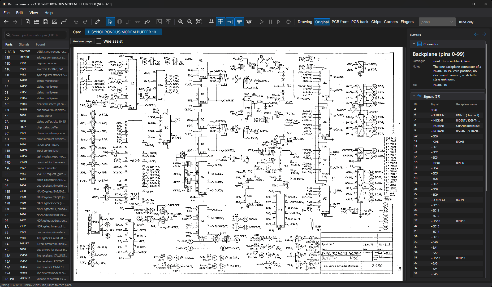

# RetroSchematic

[](https://github.com/RetroCoreLabs/RetroSchematic/actions/workflows/build.yml)
[](LICENSE)

**RetroSchematic turns hand-drawn Norsk Data circuit drawings from the 1970s into a machine-readable list of chips and wires, and draws them again in either ND's own gate symbols or modern ones.**

[What it does](#what-you-can-use-it-for) · [Getting started](#getting-started) · [Quick start](#quick-start) · [Format](src/docs/FORMAT.md) · [About the drawings](#about-norsk-data-circuit-drawings)



## Why it exists

The only record of how many Norsk Data cards worked is a scanned drawing. The scans are hard
to read, the symbols are ND's own rather than the usual ones, and the OCR text of the drawing
pages is nonsense. Emulating a card, rebuilding it in KiCad or Logisim, or moving it onto an
FPGA all need the same thing first: every chip and every wire, written down once, with how sure
each reading is.

This repository holds that written-down form (one JSON file per drawing sheet), the scans it
was read from, and the tools that check and draw it.

## What you can use it for

- **Look at a card in a window** - the viewer draws a sheet in ND's 1976 symbols or modern
  ones, in a choice of colour themes. Wires go round chips, never through them, and signal
  values are coloured the way Logisim does it (1, 0, Z, unknown).
- **Trace a signal** - click a wire, pin, tag or list entry and every place the signal reaches
  pulses. The Details panel lists its pins, the chip that drives it, its drive type
  (open-collector, three-state), its description and where it leaves the card. Back and
  Forward work like a web browser (Alt+Left / Alt+Right, mouse side buttons).
- **See how a chip works** - each chip's pins, functions and behaviour come from its
  datasheet, with the page: truth table, output enable, which clock edge it latches on, and
  set/clear pins.
- **Edit a card** - read-only by default; in edit mode place chips, connect wires, make
  virtual buses and blocks (sub-circuits, like Verilog modules or KiCad sheets), and type
  signal descriptions. Everything can also be done through the MCP server.
- **See the connectors** - backplane and front connectors are drawn as parts and wired to the
  chips, with ND's bus signal names from the bus catalogues.
- **See the real card** - switch between the drawing, the original scanned page and photos of
  the board's front and back (toolbar or F5-F8), each with its own zoom. File > Board info
  holds the board's facts (part number, print and ECO version, size, layers), its connectors
  and its switches with what each lever does; a `.rsx` file carries all of it, photos included.
  Board facts and photos can be imported from the ND PCB catalogue (`pcb.json`).
- **Find a chip on the board photo** - the Chips button (F9) draws a named box on every chip,
  placed by the board's position grid (13D, 7-8C-D); hover names the chip, a click picks it.
  Boxes and the board corners can be adjusted by hand. Board types are in
  `src/catalog/boards/` (NORD-10 card columns measured from photos of 26 boards).
- **Edge fingers on the PCB photos** - every gold finger of the card edge is labelled with its
  pin and signal, on both sides; hover for details, click to trace the signal. NORD-10 rule
  (proven on 2A50): finger k from the left is pin 2k on the component side and 2k+1 behind it
  (`src/docs/NORD10-EDGE-FINGERS.md`). The NORD-10 backplane - slots, bus wiring, IDENT/GRANT
  chains - is in `src/docs/NORD10-BACKPLANE.md`.
- **Whole cards with many pages** - one file holds a whole card (format version 3): every
  schematic page, with signals shared across the card. Page tabs (Page Up / Page Down), a card
  overview (F4), and off-page markers that jump to the page a signal continues on. The Original
  view follows the drawn page. Crowded pages can be split automatically (View menu).
- **Assisted reading of a scanned page** - on the Original view (F6), Analyse page marks chips,
  gates and position codes, offline with small trained networks (`src/models/`). Accept a find
  as a part and connect wire ends to pins by hand, or let an LLM do it through the MCP tools.
  Everything the networks find is inferred until accepted.
- **Choose how names look** - an active-low signal as `/NAME` (default), `~NAME`, or ND's own
  0/1 subscript. Settings can follow the file.
- **Check a sheet file** - `retroschematic check` refuses a file with an unknown format
  version, an unknown field, a pin on two wires, or a chip type not in the catalogue.
- **Draw a sheet to SVG** - `retroschematic render`.
- **Look up a symbol, chip or bus signal** - the symbol catalogue (`src/docs/SYMBOL-CATALOG.md`),
  the chip catalogue (`src/catalog/chips/`), and the NORD-10 and ND-100 bus signal catalogues
  (`src/docs/BUS-SIGNALS.md`).

## Sheet files

A sheet is one drawing page of one card. It is stored as JSON (`src/docs/FORMAT.md`):

| Ending | What it is |
|---|---|
| `.rsc` | the JSON as text |
| `.rsx` | the same JSON zipped, together with its original drawing pages and PCB photos |

Old `.json` sheets still open. Sheets live in one folder per machine under `src/sheets/`
(`nord-10/` today). The app can register itself to open `.rsc` and `.rsx` files on
double-click (File menu, current Windows user only).

## Programs

| Program | What it is |
|---|---|
| `RetroSchematic.Cli` (`retroschematic`) | command line: check a sheet, write it as SVG, wire statistics |
| [`RetroSchematic.Desktop`](src/RetroSchematic.Desktop/README.md) (`RetroSchematic`) | the viewer and editor window |
| `RetroSchematic.Mcp` (`retroschematic-mcp`) | MCP server over standard input and output: read, trace and change sheets with the same rules as the window (see [the viewer](src/RetroSchematic.Desktop/README.md#mcp-server)) |

## Status

Version 0.1.0, no tagged release yet. Nothing is pushed to GitHub yet.

- **One card is read:** NORD-10 sheet 2A50, the synchronous modem buffer card 1050. Every
  chip, gate and wire is read pin by pin, then re-read by a second reader, which corrected
  the clock of the receive interrupt enables. How its interrupts work is explained in
  `src/docs/2A50-interrupts.md`.
- **Symbol catalogue:** all 128 parts of ND-13.003.01, drawn in ND and modern style.
- **Chip catalogue:** 131 chip files from datasheets, with behaviour as data. A few have no
  behaviour, and say why: no datasheet was found, or the datasheet gives no logic function.
- **Bus catalogues:** NORD-10 (55 signals) and ND-100 (68 signals, with the ND-120 names),
  plus connector files for the NORD-10 backplane and modem front, the ND-100 C plug and the
  ND-120 CPU's A and B plugs.
- **Tests:** 648, all passing (run 2026-11-24): 592 for the libraries, 56 for the window. Run
  them with the command in Quick start. Known test problems are in `src/docs/BUGS.md`.
- **Outstanding work** (simulator, KiCad/Logisim converters, Verilog export, more cards) is in
  `src/docs/PLAN.md`.

## Getting started

This is for using the programs from a download, with no source code and no .NET install. To
build from source instead, see [Quick start](#quick-start).

### 1. Download and unpack

Open the [Releases page](https://github.com/RetroCoreLabs/RetroSchematic/releases) and take the
file for your computer. Each one unpacks to a single folder, `RetroSchematic-<version>-<platform>`.
`SHA256SUMS.txt` on the same page holds the checksum of every file.

| Computer | File |
|---|---|
| Windows (64-bit) | `RetroSchematic-<version>-win-x64.zip` |
| Linux (64-bit Intel/AMD) | `RetroSchematic-<version>-linux-x64.tar.gz` |
| Mac with Apple silicon (M1 and later) | `RetroSchematic-<version>-osx-arm64.tar.gz` |
| Mac with an Intel processor | `RetroSchematic-<version>-osx-x64.tar.gz` |

**Windows** - right-click the zip, Extract All, or in PowerShell:

```powershell
Expand-Archive RetroSchematic-<version>-win-x64.zip -DestinationPath .
cd RetroSchematic-<version>-win-x64
.\cli\retroschematic.exe --version
```

The programs are not signed, so Windows SmartScreen may warn the first time; choose
More info, Run anyway.

**Linux:**

```sh
tar -xzf RetroSchematic-<version>-linux-x64.tar.gz
cd RetroSchematic-<version>-linux-x64
chmod +x RetroSchematic retroschematic-mcp cli/retroschematic
./cli/retroschematic --version
```

The `chmod` is only needed if your unpacking tool lost the executable flags; `tar` keeps them.
The window program uses X11 through Avalonia. Not checked on a plain Linux desktop yet: if it
will not start, the X11 and font libraries are the first thing to look at (on Ubuntu
`libx11-6`, `libice6`, `libsm6`, `libfontconfig1`).

**macOS** - unpack with `tar -xzf` as on Linux. The programs are
signed ad hoc but not notarised by Apple, so macOS blocks a downloaded copy until the
quarantine flag is removed. Run this once in Terminal, in the folder that holds the unpacked
folder (use `osx-x64` on an Intel Mac):

```sh
xattr -dr com.apple.quarantine RetroSchematic-<version>-osx-arm64
```

The macOS builds are made and signed on GitHub's Mac machines; they have not been started on a
Mac by us yet.

### 2. What is in the folder

| Path | What it is |
|---|---|
| `RetroSchematic` (`.exe` on Windows) | the viewer and editor window |
| `retroschematic-mcp` (`.exe`) | the MCP server, for an AI assistant |
| `cli/retroschematic` (`.exe`) | the command-line tool (in its own folder because on Windows and macOS its name would clash with the window program's) |
| `catalog/` | the chip, bus signal, connector, board and passive-part files the programs read |
| `models/` | the three small trained networks for reading a scanned page |
| `sheets/` | the sample sheets: `demo/demo-gates.rsc` and the NORD-10 card 2A50 in `nord-10/` |

Each program is one self-contained file: nothing else to install. Keep the folder together -
the programs find `catalog/` and `models/` beside themselves.

### 3. Open the 2A50 sample

Start `RetroSchematic` (double-click `RetroSchematic.exe` on Windows), then File > Open sheet...
and pick `sheets/nord-10/2A50-sync-modem-buffer-1050.rsx`. The `.rsx` holds the scanned drawing
page and the board photos as well (F5-F8 switch between them). File > Open the demo sheet opens
the small demo. A sheet can also be given on the command line:
`RetroSchematic.exe sheets\nord-10\2A50-sync-modem-buffer-1050.rsx`. (The window program from a
download has not been started by us yet on any system; the command-line tool and the MCP
server have, on Windows and Linux.)

### 4. Open your own sheets

File > Open sheet... opens any `.rsc` or `.rsx`, wherever it is kept. On Windows, File > Open
.rsc/.rsx files with RetroSchematic makes a double-click on such a file open it (for the
current Windows user only; it records where `RetroSchematic.exe` is, so run it again if you
move the folder). There is no file association on Linux or macOS yet.

**Which catalogue a sheet uses.** Every program looks for a `catalog` folder (one holding
`catalog/chips`) in this order:

1. the sheet's own folder, then each folder above it;
2. the program's own folder, then each folder above it.

So a sheet kept next to its own `catalog` folder (in a checkout of this repository, for
example) uses that one, and a sheet kept anywhere else uses the one in the download. The page
reader always uses `models/` beside the program.

**Newer catalogues.** The catalogue grows as cards are read. To update a download without a
new release, copy the folders `chips`, `signals`, `connectors`, `boards` and `passives` from
[`src/catalog/`](src/catalog/) in this repository over the ones in the download's `catalog/`.
Newer sample sheets are in [`src/sheets/`](src/sheets/) (the `.rsx` files are stored with Git
LFS; download them from GitHub's file page, not as raw text).

### 5. The command-line tool

From the unpacked folder (Windows shown; on Linux and macOS use `./cli/retroschematic`):

```powershell
.\cli\retroschematic.exe --version
.\cli\retroschematic.exe check sheets\nord-10\2A50-sync-modem-buffer-1050.rsx
.\cli\retroschematic.exe render sheets\nord-10\2A50-sync-modem-buffer-1050.rsx 2A50.svg nd
```

`retroschematic` with no arguments lists every command.

### 6. The MCP server

`retroschematic-mcp` talks MCP over standard input and output, so an MCP client starts it
itself. Give the client the full path of the program in the unpacked folder. Most clients
(Claude Code's `.mcp.json`, Claude Desktop's `claude_desktop_config.json`) take this form,
with your own path:

```json
{
  "mcpServers": {
    "retroschematic": {
      "command": "<unpacked folder>/retroschematic-mcp"
    }
  }
}
```

On Windows the command ends in `retroschematic-mcp.exe` (write `\\` for each `\` in JSON).
The server answers the MCP handshake and `open_sheet` / `analyse_page` on the 2A50 sample from
the unpacked folder (tested on Windows and Linux); the client setup above has not been tried
with each client. Give `open_sheet` a full path to the sheet. The tools are listed in
[the viewer's README](src/RetroSchematic.Desktop/README.md#mcp-server).

### Building from source instead

Clone the repository with Git LFS and follow [Quick start](#quick-start); the programs then
use `src/catalog`, `src/models` and `src/sheets` directly. A release is made by pushing a
`v*` tag: `.github/workflows/release.yml` runs every test, then builds the downloads above.

## Prerequisites

| # | Requirement | Needed for | How to check |
|---|---|---|---|
| P1 | .NET SDK as pinned in `src/global.json` | building | `dotnet --info` |
| P2 | Git LFS | the scans under `src/docs/sources/` | `git lfs version` |

## Quick start

```powershell
# from the src folder
dotnet test RetroSchematic.slnx -nodeReuse:false
dotnet run --project RetroSchematic.Cli -- check sheets\nord-10\2A50-sync-modem-buffer-1050.rsc
dotnet run --project RetroSchematic.Cli -- render sheets\nord-10\2A50-sync-modem-buffer-1050.rsc 2A50.svg nd
dotnet run --project RetroSchematic.Desktop -- sheets\nord-10\2A50-sync-modem-buffer-1050.rsc
```

Use `modern` instead of `nd` for modern gate symbols.

## Current limitations

- **Only one card is read so far.** A library of NORD-1, NORD-10 and ND-100 cards is planned.
- **No simulator yet** - the run/step buttons and value colours exist, but nothing simulates.
- **No KiCad, Logisim or Verilog export yet.**
- **Busy sheets still have long wires** - a large card like 2A50 draws correctly but is
  crowded; connector boxes and chips can be moved by hand.

## About Norsk Data circuit drawings

Norsk Data (Oslo, 1967-1992) built the NORD-10, ND-100 and ND-500 minicomputers. Their circuit
drawings use a house symbol set built from NAND and NOR boxes with straight lines only, a 0/1
subscript on every signal name for its active level, and a board position (column number, row
letter, such as 13D) for every chip. The symbols are defined in ND-13.003.01 "Circuit Diagram
Symbols" (July 1976), which is in `src/docs/sources/manuals/`.

## Documentation

- [The file format](src/docs/FORMAT.md) - fields, the version rule, how sure a reading is
- [Sheet 2A50 reading](src/docs/2A50-reading.md) - register-level reading of the sync modem card
- [Sheet 2A50 interrupts](src/docs/2A50-interrupts.md) - how LEV10 and LEV12 are raised and cleared
- [Sheet 2A50 against the catalogue](src/docs/2A50-catalogue-map.md) - every drawn element matched to its symbol and chip
- [Symbol catalogue](src/docs/SYMBOL-CATALOG.md) - every ND symbol, both styles, with chip data
- [Chip file format](src/catalog/chips/FORMAT.md) - pins and behaviour from datasheets
- [Bus signals](src/docs/BUS-SIGNALS.md) - NORD-10 and ND-100 bus, sources and where they disagree
- [The viewer](src/RetroSchematic.Desktop/README.md)
- [Importing a new card](src/docs/IMPORT-WORKFLOW.md) - the workflow from PDF pages to a
  checked card, in AI mode or by hand with AI on demand, and how read cards improve the models
- [Reading a card: the checklist](src/docs/READING-A-CARD.md) and
  [adding an unknown symbol](src/docs/ADDING-A-SYMBOL.md)
- [The offline reader: what was learned](src/docs/RECOGNITION-LEARNINGS.md) and
  [how to run an improvement round](src/tools/recognition/README.md#running-an-improvement-round)
- [Plan](src/docs/PLAN.md) - outstanding work
- [Known bugs](src/docs/BUGS.md)

## Contributing

See [CONTRIBUTING.md](.github/CONTRIBUTING.md). Security problems go through
[SECURITY.md](.github/SECURITY.md), never a public issue.

## Licence

The code is MIT licensed - see [LICENSE](LICENSE). The scanned drawings and manuals under
`src/docs/sources/` are Norsk Data documents, the chip datasheets under `src/datasheets/` belong
to their makers (Texas Instruments, National Semiconductor, SMC and others), and the PCB photos
under `src/sheets/` belong to their owner. None of them are covered by that licence.
